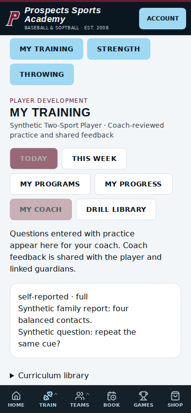
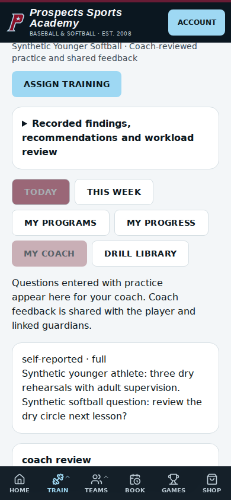
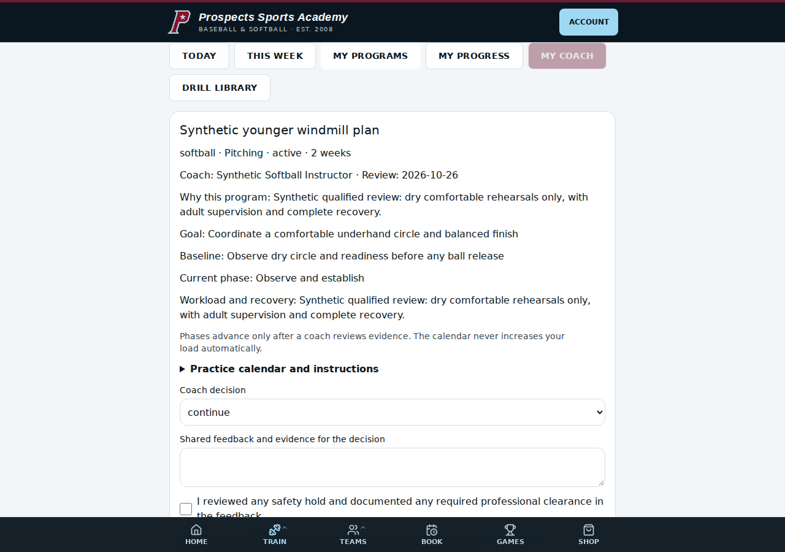

# Player Development V2 completion — 13 October 2026 (UTC)

Release PR: [198](https://github.com/nolanmccutcheon345-star/Oklahoma-Prospects-Website/pull/198). This report supersedes the earlier core-release scope; it does not claim independent professional endorsement of new coaching material.

## 1. Existing components preserved

Existing athlete and household identities, coach assignments, intake and evaluations, TP1–TP7, command/TCI and bullpen records, recruiting verification, service catalog and booking snapshots, payments, contractor earnings, prior lesson history, throwing and strength plans remain intact. Existing instructions and completed activity retain saved snapshots. There are no price changes or new payment products.

## 2. Added or improved components

- Fifty-one specialty program sequences, each with an objective, baseline, equipment, four named phases, explicit drill pairs, distinct checkpoints, regression guidance, recovery, completion criteria and next-step guidance.
- Three differentiated lesson approaches, with previews of all eight stages and actual drill instructions, cues, errors, regressions, equipment and measurement guidance.
- Drill-specific corrections, coaching cues and progression guidance across the 125-record catalog. Original academy content is retained; baseball and windmill pitching adaptations remain separate.
- Recommendations trace actual goals, intake, evaluation notes, completed assessments, prior lessons, TCI/bullpens and measurements. They display missing evidence and describe keyword matching as a review aid; no diagnosis or athlete score is fabricated.
- Combined review of recorded outings, workload, bookings, throwing/strength plans, home activity and concurrent coach assignments. A changed assignment list forces the coach to reload before adding workload.
- Persistent, permission-scoped in-app safety notices and private academy coaching-quality feedback. No new external email or messaging delivery is claimed.
- Academy review, recommendation and retirement of built-in drills/programs, with version-aware approval, reviewer identity, timestamp, reason, conflict detection and audit history. Custom drill versions and lesson presets retain their existing review workflows.

## 3. Lesson-template coverage

Each cell below contains three selectable authored approaches: foundations, targeted skill and game performance. Timing remains bound to the booked duration and the existing eight-stage structure. The 90 combinations are curriculum drafts requiring qualified individual review, not 90 independently certified professional curricula. Shared stage structure and age-filtered reuse are not counted as additional unique templates.

| Sport | Booked service discipline | 30 minutes | 60 minutes | 75 minutes |
|---|---|---:|---:|---:|
| Baseball | Pitching | 3 | 3 | 3 |
| Baseball | Hitting | 3 | 3 | 3 |
| Baseball | Catching | 3 | 3 | 3 |
| Baseball | Fielding | 3 | 3 | 3 |
| Baseball | Strength/Speed | 3 | 3 | 3 |
| Softball | Pitching | 3 | 3 | 3 |
| Softball | Hitting | 3 | 3 | 3 |
| Softball | Catching | 3 | 3 | 3 |
| Softball | Fielding | 3 | 3 | 3 |
| Softball | Strength/Speed | 3 | 3 | 3 |

Total: 45 baseball and 45 softball combinations. Tests verify distinct drill sequences across the three approaches, eight stages and exact booked-minute totals. Low-age/skill filtering may reuse safe foundations; it never unlocks advanced content just to differentiate a template. Unsupported or ambiguous legacy booking identity still requires documented admin resolution.

## 4. Distinct drills

There are **125 unique IDs**, counted once. Shared field skills legitimately apply to both sports; sport eligibility totals must not be summed as distinct content.

| Sport | Pitching | Hitting | Catching | Fielding | Strength/Speed |
|---|---:|---:|---:|---:|---:|
| Baseball | 24 | 20 | 20 | 20 | 20 |
| Softball | 20 | 21 | 20 | 20 | 20 |

Each record has written execution instructions, equipment, purpose, cues, corrections, easier/harder variants, measurement, minimum age/skill, supervision, safety, dose guidance, provenance and version. Dose is individualized by the qualified coach; the catalog does not invent a universal throwing or lifting prescription. Demonstration links are optional and must be real; none are fabricated.

## 5. Available programs and eligibility

There are **25 baseball and 26 softball specialty drafts**, in addition to the ten general sport/discipline families used for custom plans. The table gives effective minimum eligibility, including every drill in all four phases. Age does not imply skill. Six age bands (5–7, 8–10, 11–12, 13–14, 15–18, 19+) and five independent skill levels remain separate. A qualified coach must consider readiness, restrictions and supervision even when minimums are met.

| Sport | Discipline | Program | Minimum age | Minimum reviewed skill |
|---|---|---|---:|---|
| baseball | Hitting | Balanced contact foundation | 5+ | beginner |
| baseball | Hitting | Load, rhythm and moving-ball timing | 8+ | developing |
| baseball | Hitting | Barrel control across locations | 8+ | developing |
| baseball | Hitting | Strike-zone recognition and decisions | 8+ | developing |
| baseball | Hitting | Situational offense and two-strike approach | 11+ | intermediate |
| baseball | Hitting | Controlled swing efficiency before bat-speed work | 13+ | intermediate |
| baseball | Catching | Receiving setup and glove control | 5+ | beginner |
| baseball | Catching | Blocking, recovery and ball location | 8+ | developing |
| baseball | Catching | Transfer, footwork and throwing preparation | 8+ | developing |
| baseball | Catching | Catcher communication and game management | 11+ | intermediate |
| baseball | Fielding | Infield approach and glove fundamentals | 5+ | beginner |
| baseball | Fielding | Outfield reads, routes and tracking | 8+ | developing |
| baseball | Fielding | Base-specific footwork and transfers | 8+ | developing |
| baseball | Fielding | Relays, backups and defensive decisions | 11+ | intermediate |
| baseball | Fielding | Position-player throwing preparation | 8+ | developing |
| baseball | Strength/Speed | Foundational movement and balance | 5+ | beginner |
| baseball | Strength/Speed | Bodyweight strength and postural control | 8+ | developing |
| baseball | Strength/Speed | Trunk control and rotational movement | 8+ | developing |
| baseball | Strength/Speed | Acceleration posture and controlled stopping | 8+ | developing |
| baseball | Strength/Speed | Landing control before explosive training | 8+ | developing |
| baseball | Strength/Speed | Mobility and recovery awareness | 5+ | beginner |
| baseball | Pitching | Beginner overhand preparation | 5+ | beginner |
| baseball | Pitching | Delivery rhythm and direction | 8+ | developing |
| baseball | Pitching | Fastball command and location | 11+ | intermediate |
| baseball | Pitching | Competitive sequencing and reassessment | 15+ | elite |
| softball | Hitting | Balanced contact foundation | 5+ | beginner |
| softball | Hitting | Load, rhythm and moving-ball timing | 8+ | developing |
| softball | Hitting | Barrel control across locations | 8+ | developing |
| softball | Hitting | Strike-zone recognition and decisions | 8+ | developing |
| softball | Hitting | Situational offense and two-strike approach | 11+ | intermediate |
| softball | Hitting | Controlled swing efficiency before bat-speed work | 13+ | intermediate |
| softball | Catching | Receiving setup and glove control | 5+ | beginner |
| softball | Catching | Blocking, recovery and ball location | 8+ | developing |
| softball | Catching | Transfer, footwork and throwing preparation | 8+ | developing |
| softball | Catching | Catcher communication and game management | 11+ | intermediate |
| softball | Fielding | Infield approach and glove fundamentals | 5+ | beginner |
| softball | Fielding | Outfield reads, routes and tracking | 8+ | developing |
| softball | Fielding | Base-specific footwork and transfers | 8+ | developing |
| softball | Fielding | Relays, backups and defensive decisions | 11+ | intermediate |
| softball | Fielding | Position-player throwing preparation | 8+ | developing |
| softball | Strength/Speed | Foundational movement and balance | 5+ | beginner |
| softball | Strength/Speed | Bodyweight strength and postural control | 8+ | developing |
| softball | Strength/Speed | Trunk control and rotational movement | 8+ | developing |
| softball | Strength/Speed | Acceleration posture and controlled stopping | 8+ | developing |
| softball | Strength/Speed | Landing control before explosive training | 8+ | developing |
| softball | Strength/Speed | Mobility and recovery awareness | 5+ | beginner |
| softball | Pitching | Beginner windmill coordination | 5+ | beginner |
| softball | Pitching | Windmill drive, rhythm and release | 8+ | developing |
| softball | Pitching | Windmill location and reset routine | 11+ | intermediate |
| softball | Pitching | Windmill game choices and familiar movement | 15+ | advanced |
| softball | Hitting | Softball slap footwork and short game | 8+ | developing |

## 6. Lengths and progression

Plans support 2, 4, 6, 8 and 12 weeks. The coach selects frequency, individual dose/rest, start/review dates, measurable baseline, target and rationale, then previews and can edit each scheduled task before publishing. Dates organize practice; they never automatically promote a phase. Later-phase logs are rejected until the coach advances the plan. Advancement and completion require coach-observed evidence from the current phase; old observations and family self-reports cannot establish mastery. Repeat, modify, pause and reviewed resume remain available.

## 7. Parent/player workflow verification

Authenticated acceptance covers a 13-year-old baseball player and a younger softball player in one household: open assigned instructions, record practice/outcomes/questions, log out and return, view persisted feedback, switch siblings without leaking reports, and see phase/recovery context. Today, This Week, My Programs, My Progress, My Coach and Drill Library remain connected to durable records. The week view lists seven days; unscheduled days do not invent mandatory activity.

## 8. Instructor workflow verification

Acceptance covers both sports and 30/60/75-minute booked lessons, durable draft reload, completion once, contractor earnings once, custom drill draft submission, individual home-plan approval and the next-lesson development brief. The extended case assigns a specialty windmill program through a second instructor, records family work, reviews it as the first assigned instructor and reads the shared feedback as the second instructor and parent. Both instructors see the same athlete record within their assigned scope.

## 9. Persistence and permission verification

Server integration tests cover unrelated households/instructors, sibling isolation, admin-only curriculum/quality decisions, server-derived actors, immutable instruction snapshots, duplicate assignment retries, stale report revisions, changing concurrent workload, preserved coach observations, phase evidence, private coaching context, retired content and conflicting academy decisions. Family responses omit private evaluation/workload context and academy quality notes. Self-report never writes verified recruiting measurements. Additive migrated disposable PostgreSQL is used for automated acceptance; customer records are not test fixtures.

## 10. Sport-specific workload and safety

Recorded baseball game-pitch counts drive age-appropriate rest checks for ages 7–18; threshold tests include the different 15–16 and 17–18 boundaries. Adult or incomplete records require explicit qualified review. Softball windmill programs never inherit baseball pitch-count limits. Cross-program pain or unusual fatigue pauses active plans and creates scoped in-app notices. The application does not diagnose injury or provide return-to-throw clearance.

The workload panel exposes its underlying records, overlapping plans and missing-data warnings. Home repetition reports remain separate from recorded game pitches; they are not silently double-counted or represented as a medically validated cumulative dose. External team activity must be confirmed by the coach. Youth strength material emphasizes controlled technique, prerequisites and qualified supervision rather than maximum-load targets.

Reference basis, not authorship or endorsement of individual drills: [Pitch Smart](https://www.mlb.com/pitch-smart/pitching-guidelines), [AAP overuse prevention](https://www.healthychildren.org/English/health-issues/injuries-emergencies/sports-injuries/Pages/Preventing-Overuse-Injuries.aspx), [AAP resistance training policy](https://publications.aap.org/pediatrics/article/145/6/e20201011/76942/), and [Nationwide Children’s baseball/softball injury prevention](https://www.nationwidechildrens.org/family-resources-education/700childrens/2017/01/injury-prevention-in-softball-and-baseball).

## 11. Release checks and workflow screenshots

Code commit `7526e189ffaafb89e8d7f9679476bf59fbafe1f0` passed [CI run 38341981657](https://github.com/nolanmccutcheon345-star/Oklahoma-Prospects-Website/actions/runs/38341981657): **889/889 regression tests**, authenticated built-application browser acceptance, typecheck, production build, built-server smoke, lint (zero errors; existing repository warnings remain) and dependency audit (zero vulnerabilities). No skipped or failed regression is counted as passed.

The successful [workflow artifact](https://github.com/nolanmccutcheon345-star/Oklahoma-Prospects-Website/actions/runs/38341981657/artifacts/11786879593) contains 17 screenshots and the six-case walkthrough result with **zero browser errors**. The expanded family/coach loop also completed successfully. These retained examples were visually inspected at 390×844 and 1280×900; content fits the viewport and remains scrollable around the existing navigation:

The hosted preview passed read-only routes, headers, fresh CSP nonce, private-cache, anonymous-session and restricted database-health checks. Production/preview PostgreSQL destination fingerprints are distinct. The first expanded browser run encountered the synthetic clients' shared-IP login limit; the corrected harness assigns distinct synthetic users their own addresses without disabling production authentication or rate limits. The successful rerun is the release evidence.

Publication is authorized by the owner's explicit request. The PR records the production commit, deployment receipt and final read-only verification after merge. This report and its screenshots do not change the tested application or migrations.

## 12. Remaining limitations and missing content

- New curriculum is authored coaching material awaiting qualified human review. Publication is not a claim that a baseball, windmill or youth-strength specialist has independently approved every entry. The required review gate remains before athlete-specific assignment.
- No invented video demonstrations, automatic medical clearance, automatic maximum-effort velocity prescriptions, or fabricated progress scores are supplied. Related demonstration libraries can be extended through reviewed content versions.
- Recommendation ranking is explainable matching against recorded evidence. Missing or stale intake, outside-team activity and medical restrictions require coach confirmation; no external workload integration is implied.
- In-app safety notices are verified. This release does not add SMS/push/email delivery guarantees or independently exercise a live Square charge, refund or email provider. Existing payment regression coverage remains part of the full suite.
- Authenticated write acceptance uses the actual built application and real middleware against disposable migrated data. Production verification is read-only and tied to the published commit; customer accounts are not modified for QA.

## 13. Database and historical records

Migration 0059 adds only the curriculum control table, RLS/public-access restrictions and audit trigger. Earlier applied migrations 0056–0058 and all historical records remain unchanged. Saved athlete content remains readable after retirement; new selections are blocked. Approval applies to the reviewed content version, and retirement persists until an admin changes it. Actor/time/reason and conflicting decisions are recorded server-side. No direct production DDL or customer-data rewrite is used; Netlify applies committed migrations during deploy. Production and preview database fingerprints are checked for separation.
